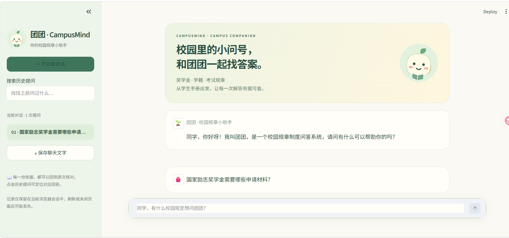
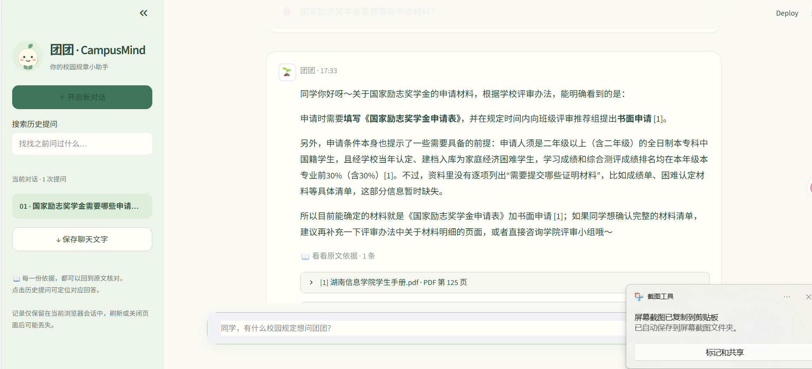

# CampusMind：校园知识问答系统

CampusMind 是一个基于校园资料的问答系统，当前以《湖南信息学院学生手册》为主要知识来源，支持通过网页或终端咨询奖学金、学籍、考试等校园规章问题。

项目采用 RAG（检索增强生成）：先从知识库检索与问题相关的原文，再交给大语言模型组织回答，并提供引用编号、文件名称和 PDF 页码，方便核对依据。


## 界面展示





## 主要功能

- PDF 逐页 OCR 文字识别
- 文档清洗、章节与父子片段结构化
- 子片段向量入库（Chroma），并保存父级原文快照
- 多轮问题补全、类别澄清与查询改写
- BM25 + 向量混合检索、候选重排
- 带引用的回答生成、轻量引用校验与来源展示
- 会话管理与阶段耗时记录

奖学金章节做了专门结构化；其余内容主要按页面组织，尚未实现全手册的自动章节识别。

## 整体流程

**资料准备**：PDF → 逐页 OCR → 清洗与结构化（父子片段）→ 子片段向量入库 → 保存父级快照。

**在线问答**：问题 → 校验/补全/澄清 → 查询改写 → 混合检索 → 重排 → 扩展父级上下文 → 生成回答 → 校验引用（不通过时重试一次，仍不通过则改为提示资料不足）→ 返回回答与来源。

## 项目结构

```text
CampusMind/
├── main.py                 # 终端问答入口
├── app.py                  # Streamlit 网页入口
├── ingest.py               # 资料入库入口
├── config.py               # 统一配置
├── smoke_api.py            # DeepSeek 接口冒烟脚本
├── campusmind/
│   ├── document_processing.py  # OCR、清洗与父子片段
│   ├── knowledge_base.py       # 校验、向量入库与父级快照
│   ├── query_processing.py     # 校验、补全、澄清、改写
│   ├── retrieval.py            # BM25 + 向量检索与融合
│   ├── reranking.py            # 重排与父级上下文选择
│   ├── generation.py           # 提示词、回答生成与引用检查
│   ├── session_manager.py      # 会话历史
│   ├── qa_service.py           # 统一问答服务
│   └── cli.py                  # 分阶段调试 CLI
├── new_data/               # 原始 PDF、OCR、结构化结果与向量库
├── evaluation/             # 问答效果评估
└── tests/                  # 离线功能测试
```

## 安装与配置

以下命令以 Windows CMD 为例，均在项目根目录执行。

```cmd
cd /d D:\VsCodeProjects\CampusMind
py -3.12 -m venv .venv
.\.venv\Scripts\python.exe -m pip install -r requirements.txt
```

复制配置模板并填写密钥：

```cmd
copy .env.example .env
```

```dotenv
DEEPSEEK_API_KEY=你的DeepSeek密钥
SILICONFLOW_API_KEY=你的硅基流动密钥
DEEPSEEK_MODEL=deepseek-flash
CAMPUSMIND_COLLECTION=campus_handbook_bge_m3_v2
```

密钥只从环境变量或根目录 `.env` 读取，不写入代码。

## 准备资料与建立知识库

已有可用数据库与父级快照时，可直接跳到「启动问答」。

1. 放置原始 PDF 到 `new_data/raw/湖南信息学院学生手册.pdf`（更换 PDF 需同步调整章节/页码规则）。
2. 生成 OCR：

```cmd
.\.venv\Scripts\python.exe -c "from config import PDF_PATH, OCR_DIR; from campusmind.document_processing import preview_pdf_ocr; preview_pdf_ocr(PDF_PATH, OCR_DIR)"
```

3. 生成结构化资料：

```cmd
.\.venv\Scripts\python.exe -m campusmind.document_processing
```

4. 校验资料（不调用模型、不写数据库）：

```cmd
.\.venv\Scripts\python.exe ingest.py --check-only
```

5. 正式入库：

```cmd
.\.venv\Scripts\python.exe ingest.py
```

资料或模型版本变化时，用新集合入库（`--collection-name ...`），并同步修改 `.env` 中的集合名称。

## 启动问答

网页：

```cmd
.\.venv\Scripts\python.exe -m streamlit run app.py
```

终端：

```cmd
.\.venv\Scripts\python.exe main.py
```

## 常见运行问题

| 现象 | 原因 | 处理 |
|---|---|---|
| 网页能打开但输入框是灰的，顶部提示缺少密钥 | 项目根目录没有 `.env`，或密钥为空 | 复制 `.env.example` 为 `.env`，填写两个密钥后重启 |
| 终端提示“未配置 …_API_KEY，请在项目根目录 .env 中填写” | 同上 | 同上 |
| 提示“知识库尚未就绪、内容为空或配置不匹配” | `new_data/` 里的向量库和父级快照没有随仓库提供 | 按「准备资料与建立知识库」重建，或从原机器拷贝 `new_data/chroma_db` 与 `new_data/processed/index_versions/<集合名>` |
| `'streamlit' 不是内部或外部命令` | 没有使用项目虚拟环境 | 改用 `.\.venv\Scripts\python.exe -m streamlit run app.py` |
| `ModuleNotFoundError: langchain_core` 等 | 用了全局 Python 而不是项目 `.venv` | 先 `.\.venv\Scripts\python.exe -m pip install -r requirements.txt`，再用 `.venv` 里的 python 运行 |
| `git clone` 后无法直接运行 | `.env`、`new_data/`、`data/` 被 `.gitignore` 排除，仓库里只有代码 | 补 `.env`，并按上一条准备知识库；这不是代码错误 |

## 分阶段调试（CLI）

不开网页即可在终端分阶段查看问答流水线的中间结果，便于定位问题出在检索、重排还是生成：

```cmd
.\.venv\Scripts\python.exe -m campusmind.cli --stage query
.\.venv\Scripts\python.exe -m campusmind.cli --stage retrieve
.\.venv\Scripts\python.exe -m campusmind.cli --stage rerank
.\.venv\Scripts\python.exe -m campusmind.cli --stage answer
```

| 阶段 | 查看内容 |
|---|---|
| `query` | 问题补全与改写后的检索查询 |
| `retrieve` | 混合召回出的候选片段 |
| `rerank` | 重排后的排名与最终父级上下文 |
| `answer` | 完整回答、状态与阶段耗时（复用统一问答服务，含引用重试/降级） |

`answer` 阶段可用 `clear` 清空会话，`exit` 退出。`answer` 与网页、`main.py`
共用 `QAService`：引用校验失败会重试一次，仍失败则降级为资料不足；`retrieve`、
`rerank` 阶段只做检索与重排，不调用回答模型。

## 测试与评估

离线测试（不调用模型接口）：

```cmd
.\.venv\Scripts\python.exe -m unittest discover -s tests -v
```

评估（`--check-only` 只校验题目与依据，`--run` 才调用真实接口）：

```cmd
.\.venv\Scripts\python.exe -m evaluation.run_evaluation --check-only
.\.venv\Scripts\python.exe -m evaluation.run_evaluation --run --limit 3
```

接口冒烟（实际调用 DeepSeek，会消耗额度）：

```cmd
.\.venv\Scripts\python.exe smoke_api.py
```

## 主要默认参数

| 参数 | 默认值 | 含义 |
|---|---:|---|
| `CHUNK_SIZE` / `CHUNK_OVERLAP` | 500 / 80 | 子片段切分长度与重叠 |
| `RECALL_K` | 6 | 每条查询、每路召回数量 |
| `CANDIDATE_K` | 10 | 融合后候选数量 |
| `CONTEXT_TOP_N` | 3 | 最多选择的父级资料数量 |
| `MAX_CONTEXT_CHARS` | 6000 | 父级正文总字符预算 |
| `ANSWER_ATTEMPTS` | 2 | 引用校验不通过时最多生成几次（含一次重试） |
| `CITATION_SUPPORT_MIN_OVERLAP` | 0.15 | 引用句与原文数字/词面一致性检查的最小重叠比例 |
| `HISTORY_ROUNDS` | 3 | 历史轮数 |
| `MAX_QUERIES` | 3 | 完整问题 + 最多两条改写 |

修改配置后重启服务；切片或嵌入模型变化需重新构建知识库。

## 当前限制

- 知识以当前学生手册为主，OCR 可能识别错误，关键规定需人工核对。
- 部分章节使用手工规则，尚未实现任意文档自动结构化。
- 引用检查已加入数字与词面一致性校验，但仍可能误判，关键规定需人工核对。
- 父级资料无法完整放入字数预算时会被跳过并标记 `context_incomplete`，不会截断条款。
- 历史保存在内存中，未实现持久化与账号系统。

